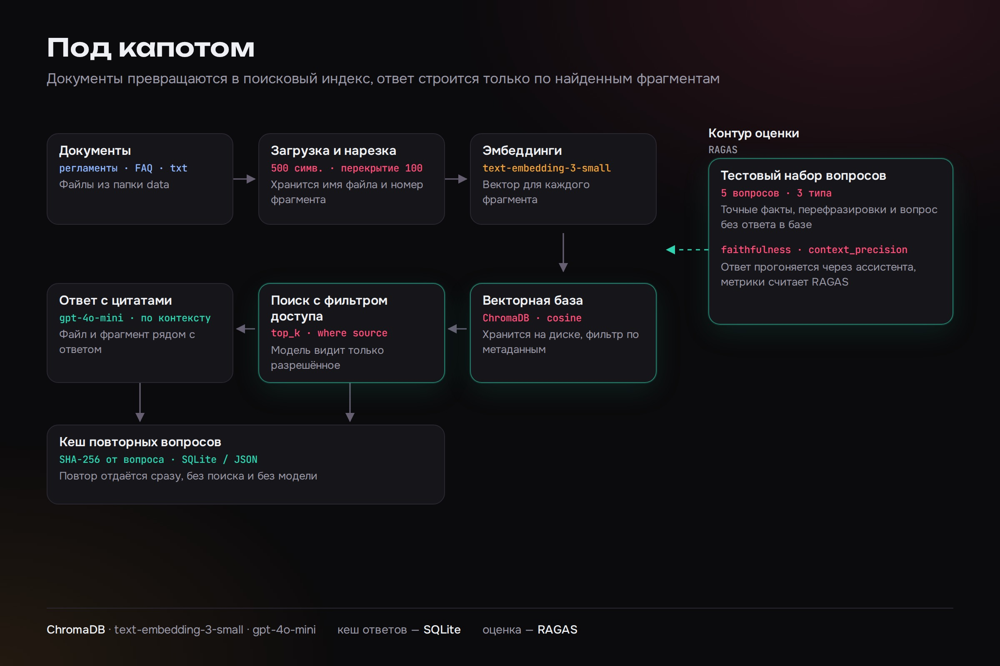
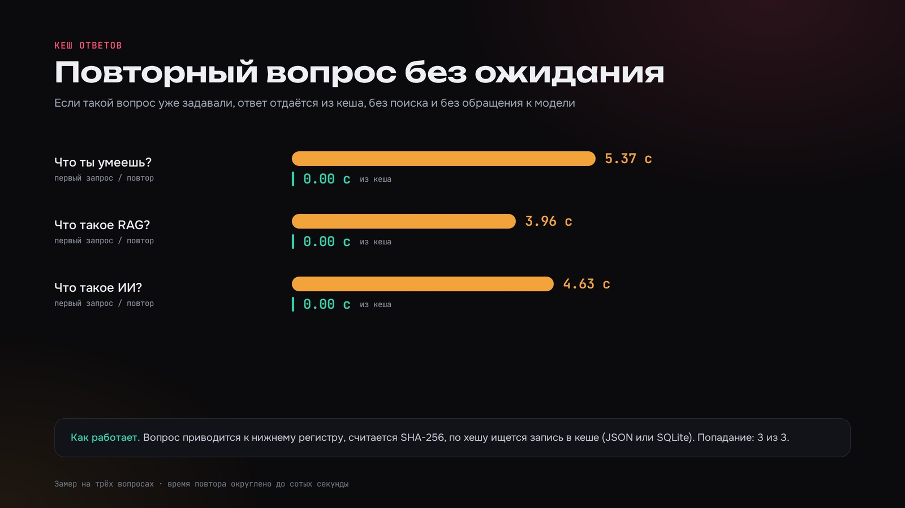

# Ассистент по документам компании (RAG)

Консольный ассистент отвечает на вопросы сотрудников по регламентам, инструкциям и FAQ. Документы загружаются из папки, нарезаются на фрагменты и сохраняются в локальную векторную базу. На вопрос модель отвечает только по найденным фрагментам, а рядом с ответом выводятся файл и номер фрагмента, из которого он взят. Если ответа в документах нет, ассистент так и пишет.

Повторные вопросы отдаются из кеша без поиска и без обращения к модели. Поиск можно ограничить одним файлом: фильтр по источнику применяется в базе до поиска, поэтому модель не видит остальные документы. Это основа для разграничения доступа: на схеме ниже роль определяет, какие источники попадут в выборку.

Для проверки качества есть скрипт оценки на RAGAS с набором вопросов трёх типов: точный факт, перефразировка и вопрос, ответа на который в документах нет.





## Запуск

```bash
python -m venv .venv && source .venv/bin/activate
pip install -r requirements.txt
cp .env.example .env        # впишите OPENAI_API_KEY
python -m src.ingest        # индексация data/demo
python -m src.cli           # консольный чат
python -m src.cli --source "FAQ.txt"   # поиск только по одному файлу
```

Команды в чате: `stats`, `clear` (очистить кеш), `exit`. Свои документы: положите `.txt` или `.md` в `data/demo` либо задайте `DATA_DIR` в `.env`, затем `python -m src.cli --reindex`.

Тесты (без ключа и сети, эмбеддинги и модель заменены заглушками):

```bash
pip install -r requirements-dev.txt && pytest
```

Оценка качества (нужен ключ): `pip install -r requirements-eval.txt && python -m eval.evaluate_ragas`. Вопросы лежат в `eval/questions.json`.

## Стек

Python, ChromaDB (cosine), OpenAI (`text-embedding-3-small`, `gpt-4o-mini`), SQLite для кеша, RAGAS.

## Структура

```
src/
  config.py      настройки из .env
  ingest.py      чтение файлов, нарезка (500 символов, перекрытие 100), запись в ChromaDB
  embeddings.py  эмбеддинги OpenAI
  retriever.py   поиск top_k с необязательным фильтром where source
  answer.py      промпт с источниками, ответ, кеш
  cache.py       кеш SQLite: SHA-256 от вопроса, фильтра и top_k
  cli.py         консольный интерфейс
eval/            RAGAS и тестовые вопросы
data/demo/       вымышленные демо-документы: регламент сервисной службы, FAQ
tests/           офлайн-тесты
```

## Лицензия

MIT — см. [LICENSE](LICENSE).
